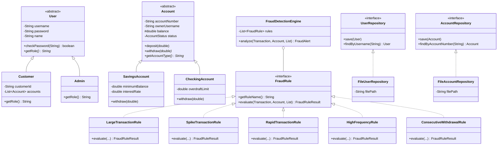

# 🏛️ Banking & Fraud Detection System

**Course Code**: 25CSE0202 — Programming in Java  
**Evaluation Dates**: November 25–28, 2026  
**Project Phase**: Phase 1 Evaluation (Core Architecture, Domain Models, Strategy Engine, and File Persistence)  
**Total Classes / Interfaces / Enums**: 46 Files across 6 Packages  

---

## 1. Problem Statement (Rubric Component 1 — 3 Marks)

### Context & Background
With the exponential rise of digital banking and electronic fund transfers, financial institutions face escalating threats from automated attacks, unauthorized account takeovers, and fraudulent transactions. Traditional banking prototypes often operate as passive ledgers, unable to detect anomalous behaviors in real time.

### Target Users & Needs Addressed
1. **Bank Customers**:
   - Require secure, multi-account management (Savings with minimum balance requirements, Checking with overdraft protection).
   - Demand transparent transaction auditing, fund transfers, and immediate protection against unauthorized account draining.
2. **Bank Fraud Analysts & Compliance Administrators**:
   - Need real-time monitoring of suspicious financial transactions.
   - Require risk classification (Low, Medium, High, Critical) and decisive mitigation mechanisms (freezing/unfreezing compromised accounts and resolving/dismissing security alerts).

---

## 2. Project Objectives & Scope (Rubric Component 2 — 2 Marks)

### Project Objectives
- **Domain Modeling**: Deliver an extensible, object-oriented representation of banking entities with polymorphic accounts (`SavingsAccount`, `CheckingAccount`) and role-based users (`Customer`, `Admin`).
- **Real-Time Fraud Detection Engine**: Implement a configurable rule engine utilizing the **Strategy & Composite Design Patterns** to evaluate transactions across velocity, spike, and amount thresholds.
- **Active Threat Mitigation**: Automatically freeze accounts when critical velocity violations are detected, and empower administrators to freeze/unfreeze accounts manually.
- **Reliable Persistence**: Implement a file-based repository layer storing users, accounts, transactions, and fraud alerts in persistent CSV format (`data/*.csv`).

### Scope Boundaries (Phase 1 vs. Future Phases)
- **Phase 1 In-Scope**:
  - Full CLI console interface for Customers and Administrators.
  - Multi-tier exception handling hierarchy (`BankException` and subclasses).
  - Rule-based fraud detection engine (5 active strategies).
  - File I/O persistence layer (CSV storage in `./data/`).
  - Account lifecycle and state management (`ACTIVE`, `FROZEN`, `CLOSED`).
- **Phase 2 & Future Roadmap**:
  - Relational Database Management System migration (JDBC with MySQL/PostgreSQL).
  - Multi-threaded transaction processing and queue-based alert dispatching.
  - Machine Learning-based anomaly scoring (isolation forests / logistic regression).
  - Graphical User Interface (JavaFX / Web Spring Boot REST API).

---

## 3. Project Design & Architecture (Rubric Component 3 — 9 Marks)

The project is structured into 6 packages comprising **46 classes, interfaces, and enums**:

### Package Breakdown

| Package | Files | Core Responsibilities |
| :--- | :---: | :--- |
| `com` | 1 | Application entry point (`Main.java`) and interactive CLI dashboard |
| `com.model` | 11 | Domain entities: `User`, `Customer`, `Admin`, `Account`, `SavingsAccount`, `CheckingAccount`, `Transaction`, `FraudAlert`, and Enums |
| `com.fraud` | 9 | Strategy pattern engine: `FraudRule`, `FraudDetectionEngine`, rule implementations, `RiskLevel`, and results |
| `com.repository` | 8 | File persistence: Repository interfaces and CSV implementations for Users, Accounts, Transactions, Alerts |
| `com.service` | 9 | Business logic: `BankingService`, `FraudMonitoringService`, `AuthenticationService`, and `Bank` facade |
| `com.exception` | 6 | Exception hierarchy: `BankException`, `InsufficientFundsException`, `AccountFrozenException`, etc. |
| `com.util` | 3 | Static utilities: `ValidationUtil`, `DateTimeUtil`, `IdGenerator` |

### Architecture Diagram



---

## 4. Integration of Course Concepts (Rubric Component 4 — 6 Marks)

The codebase exemplifies comprehensive integration of the **Programming in Java (25CSE0202)** syllabus:

1. **Object-Oriented Programming (OOP)**:
   - **Encapsulation**: Private fields, validated mutators, immutable transaction instances.
   - **Inheritance & Polymorphism**: Abstract classes `User` and `Account` extended by specialized subclasses. Method overriding in `withdraw()`, `getAccountType()`, and `getRole()`.
   - **Abstraction & Interface Segregation**: Distinct interfaces for repositories (`UserRepository`, `AccountRepository`, etc.), services (`BankingService`, `FraudMonitoringService`), and rules (`FraudRule`).
2. **Design Patterns**:
   - **Strategy Pattern**: Pluggable fraud detection strategies implementing `FraudRule`.
   - **Composite / Rule Engine**: `FraudDetectionEngine` orchestrating multiple rules.
   - **Repository Pattern**: Abstracting persistent file operations from service logic.
   - **Facade Pattern**: `Bank.java` presenting a unified interface to the presentation layer.
3. **Custom Exception Hierarchy**:
   - `BankException` (checked base exception)
   - `InsufficientFundsException` (triggered on overdraft or minimum balance breach)
   - `AccountFrozenException` (enforced when frozen accounts attempt operations)
   - `AuthenticationException` (credential failure)
   - `InvalidTransactionException` (negative amounts, self-transfers)
   - `ResourceNotFoundException` (unknown account or alert IDs)
4. **Collections Framework**:
   - Dynamic storage using `List` and `ArrayList`.
   - Synchronized thread-safe access in repository caches.
5. **File Persistence / File I/O**:
   - Data persists across application sessions via CSV files in `./data/`:
     - `users.csv`: Stores Customers and Admins.
     - `accounts.csv`: Stores Savings and Checking accounts with balances and status.
     - `transactions.csv`: Full audit trail with ISO timestamps.
     - `alerts.csv`: Recorded fraud alerts with risk level and status.
6. **Modern Date/Time API**:
   - Utilizes `java.time.LocalDateTime`, `LocalDate`, `Duration`, and `DateTimeFormatter`.

---

## 5. Setup, Build, and Execution (Rubric Component 5 — 5 Marks)

### Prerequisites
- Java Development Kit (JDK 17 or higher; JDK 26 verified).
- macOS / Linux / Windows terminal.

### Quick Start with Runner Script
An automated execution script (`run.sh`) is provided:

```bash
chmod +x run.sh
./run.sh
```

### Manual Compilation and Execution

```bash
# 1. Compile all Java source files
javac $(find com -name "*.java")

# 2. Run the application
java com.Main
```

### Default Credentials
- **Administrator**:
  - Username: `admin`
  - Password: `admin123`
- **Customer**:
  - Register any new username/password through Menu Option 1.

---

## 6. Verification and Test Scenarios

The system has been verified through automated end-to-end integration tests:

1. **Account Creation & Overdraft Validation**:
   - Created a Savings Account with \$1,000. Verified that withdrawals leaving less than the \$500 minimum balance are blocked.
   - Created a Checking Account with \$500. Verified that withdrawals up to \$1,000 overdraft are permitted.
2. **Velocity Violation & Auto-Freeze**:
   - Executed 4 rapid transactions within 60 seconds.
   - `RapidTransactionRule` triggered a **CRITICAL** risk alert.
   - System automatically set `AccountStatus.FROZEN`.
   - Subsequent deposit and withdrawal attempts were rejected with `AccountFrozenException`.
3. **Admin Alert Management & Unfreezing**:
   - Administrator logged in, inspected `ALERT-001 [CRITICAL]`, marked it as `RESOLVED`.
   - Administrator unfroze the account, restoring its status to `ACTIVE`.
4. **Data Persistence**:
   - Exited the application and inspected `./data/*.csv`.
   - Verified that all users, accounts, balances, and transaction logs remained intact across restarts.
